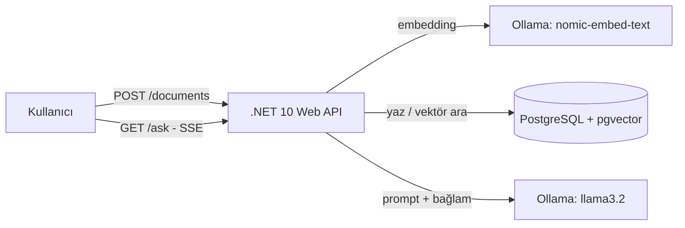

[DocAssistant canlı cevap akışı React.js Ekranı](docs/answer-demo.png)
[DocAssistant canlı cevap akışı api](docs/ask-demo.png)
# DocAssistant

Yüklenen dokümanlar üzerinde soru-cevap yapan, **RAG (Retrieval-Augmented Generation)** tabanlı bir .NET 10 Web API projesi. Cevaplar **SSE** ile canlı akıtılır. Tamamen yerelde, ücretsiz çalışır (Ollama).

## Neler yapıyor?
- Dokümanı parçalara böler (chunking, overlap'li)
- Her parça için embedding üretir ve PostgreSQL + pgvector'e yazar
- Soruya anlamca en yakın parçaları vektör aramayla bulur
- Bulunan bağlamı LLM'e verir, cevabı Server-Sent Events ile akıtır
- Alakasız sorularda "Bilmiyorum" der (mesafe eşiğiyle halüsinasyon kontrolü)

## Mimari

## Teknolojiler
.NET 10, ASP.NET Core Minimal API, Microsoft.Extensions.AI, OllamaSharp, Npgsql + Pgvector, PostgreSQL, Docker Compose, xUnit, GitHub Actions, React.js + TypeScript (Vite)

## Yerelde çalıştırma
1. [Ollama](https://ollama.com)'yı kur ve modelleri indir:
   `ollama pull nomic-embed-text` ve `ollama pull llama3.2`
2. Veritabanını başlat: `docker compose up -d`
3. Bağlantı bilgisini kaydet (`src/DocAssistant.Api` klasöründe):
   `dotnet user-secrets set "ConnectionStrings:Db" "Host=127.0.0.1;Port=5433;Database=docassistant;Username=app;Password=app_pass"`
4. Çalıştır: `dotnet run --project DocAssistant.Api`
5. Arayüzü başlat:
    `cd docassistant-web`, `npm-install`,`npm run dev` 
    Sonra tarayıcıda `http://localhost:5173` adresini aç.

> `docker-compose.yml`'deki şifre yalnızca yerel geliştirme içindir.

## Kullanım
- `POST /documents` gövde: `{ "text": "..." }`
- `GET /ask?q=sorunuz` (SSE akışı)

## Tasarım kararları
- **IChatClient / IEmbeddingGenerator soyutlaması:** Sağlayıcıyı (Ollama, Azure OpenAI vb.) kodu değiştirmeden değiştirmek için.
- **Mesafe eşiği:** Vektör arama her zaman "en yakın" sonucu getirir, alakasız olsa bile. Eşik, bu durumda LLM'e hiç gitmeden "Bilmiyorum" dönmeyi sağlar.
- **Yerel model:** Maliyetsiz ve gizlilik dostu. Dezavantajı: küçük modellerin Türkçe kalitesi sınırlı.

## Bilinen sınırlamalar
- Eşik değeri elle ayarlanıyor, otomatik değerlendirme seti yok
- Reranking henüz yok
- Aynı doküman tekrar yüklenirse tekrarlı kayıt oluşur

## Yol haritası
- [X] React + TypeScript arayüzü
- [ ] Redis önbelleği
- [ ] RabbitMQ ile asenkron doküman işleme